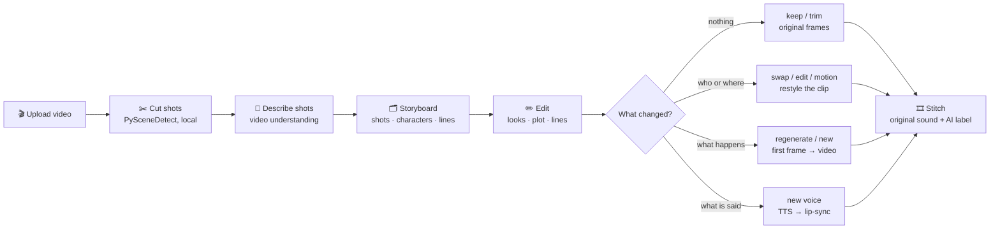
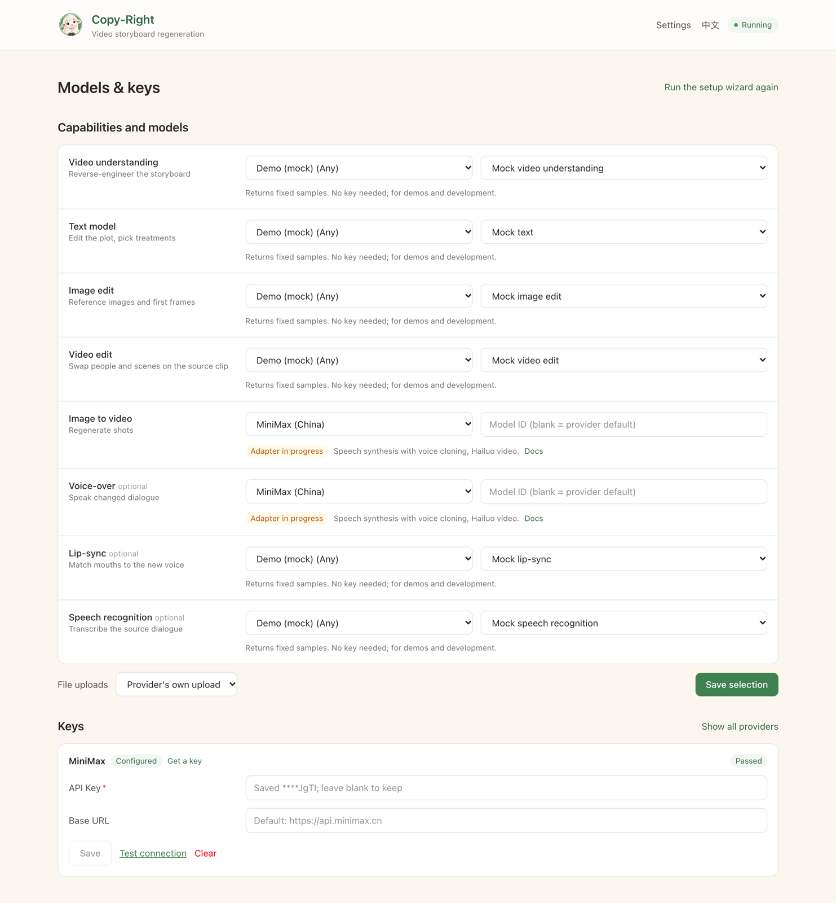

<p align="center">
  
</p>

<h1 align="center">Copy-Right</h1>

<p align="center">
  <b>Edit a finished video like a storyboard.</b><br/>
  Recast every character, rewrite a line, change the plot, and regenerate <i>only the shots that changed</i>.
</p>

<p align="center">
  <b>English</b> · <a href="README.zh-CN.md">简体中文</a>
</p>

<p align="center">
  <a href="https://github.com/zhcalvin/copy-right/actions/workflows/ci.yml"></a>
  <a href="LICENSE"></a>
  
  
  
</p>

<p align="center">
  
</p>

<p align="center">
  <sub>Left: the original. Right: the same 21 seconds after recasting all seven people, made end to end in the app.<br/>
  <a href="docs/assets/demo/compare.mp4">▶ Watch the MP4 with sound</a> (the sheep says a new line at 0:12)</sub>
</p>

---

## What happened in that clip

Copy-Right cut the clip into 6 shots and found 7 people. Each person got a new look from a single
reference image, and one shot got a new spoken line. Every other detail comes from the footage:

<p align="center">
  
</p>

| Step | In the app | Under the hood |
| --- | --- | --- |
| **1. Parse** | Upload, click *Parse* | Shots are cut locally (PySceneDetect); Qwen-VL describes each shot and links recurring people |
| **2. Recast** | *Edit* a character → upload or generate a look | Every shot that shows that character is marked 🔁 **swap** |
| **3. Add the extras** | *Add a character*, tick them in a shot | People the parser missed can be recast too |
| **4. New line** | Type a line in the shot editor, pick a voice | The shot gets 🎙 **new voice**; its picture is not regenerated |
| **5. Generate** | See the cost estimate, click *Generate* | Wan 2.7 video edit restyles each clip with the references, keeping motion, camera and timing; MiniMax speaks the line; VideoRetalk lip-syncs it |
| **6. Stitch** | Watch original vs new, download | Clips are normalized, generated shots are labelled *AI-generated*, the original soundtrack is kept (ducked under the new line) |

<p align="center">
  
  <br/><sub>Before → after for every shot. Close-ups and crowds work: one edit replaces several people at once.</sub>
</p>

The second render (for the new line) **reused all six pictures** from the first one and only paid
for the voice and lip-sync: about a minute instead of ten.

## How it works



- **The source clip is the truth.** Each shot keeps its clip and keyframes, so whatever you
  don't touch comes back frame for frame, and timing never drifts.
- **Lightest treatment first:** `keep → trim → swap → edit → motion → regenerate` (plus `new`
  and `removed`), picked from which layer you changed. You can lock a different one per shot.
- **Pay once.** Every generated shot remembers what it was made from. A later render reuses
  anything whose inputs didn't change, and the estimate counts it as free.
- **Images before video.** For regenerated shots you approve a cheap first frame before the
  expensive video is made.

## The editor

<p align="center">
  
</p>

<table>
  <tr>
    <td width="50%"><br/><sub><b>Characters.</b> Upload a look or generate one with an image model, pick a voice.</sub></td>
    <td width="50%"><br/><sub><b>Shots.</b> Edit any layer, lock a treatment, add lines, or have the shot described again.</sub></td>
  </tr>
  <tr>
    <td><br/><sub><b>Plot edits.</b> “At the end he trips over a cable”: the text model proposes changes shot by shot, each with a treatment and a reason. Accept them one by one.</sub></td>
    <td><br/><sub><b>Generate.</b> Live per-shot progress, retries (with another provider after a moderation refusal), and original vs new.</sub></td>
  </tr>
  <tr>
    <td><br/><sub><b>Cost first.</b> An estimate from list prices before anything is billed (here, recasting the full 85-second video).</sub></td>
    <td><br/><sub><b>Versions.</b> Every save is a version; restore any of them.</sub></td>
  </tr>
</table>

<details>
<summary>More screenshots (setup wizard, settings, 简体中文 UI)</summary>

| 简体中文 UI | Parsing progress |
| --- | --- |
|  |  |
| **First-run setup: pick a preset** | **Setup: test your keys (free calls only)** |
|  |  |
| **Setup: one row per capability** | **Settings → Models & keys** |
|  |  |

</details>

## Bring your own AI providers

Everything goes through pluggable adapters for 8 capabilities. Pick a preset or mix providers
per capability; a built-in **Demo** preset runs the whole flow with mock providers and no keys.

| Capability | 🇨🇳 China preset | 🌍 Global preset |
| --- | --- | --- |
| Video understanding | Alibaba Model Studio (Qwen-VL) ✅ | Gemini |
| Text (plot edits) | Model Studio (Qwen) ✅ | Gemini |
| Image edit | Model Studio (Qwen-Image) ✅ | Gemini image |
| Video edit (swap, edit, motion) | Model Studio (Wan 2.7 video edit, Wan Animate) ✅ | Runway (Gemini Omni, Aleph) |
| Image to video | Kling (or Wan 2.6 ✅) | Gemini (Veo 3.1) |
| Voice-over | MiniMax ✅ | ElevenLabs |
| Lip-sync | Model Studio (VideoRetalk) ✅ | Sync Labs |

✅ = run against the real API while building this. The others follow the providers' current
API docs and are covered by tests with mocked HTTP, but haven't been run with a live key yet.
Reports and fixes are welcome.

**Your keys stay yours.** They live only on your machine, encrypted with a master key in the
system keychain; the app only ever shows the last 4 characters. Environment variables take
priority (see [`.env.example`](.env.example)). *Test connection* only calls free, read-only
endpoints.

## Quick start

You need Python 3.11+, [uv](https://docs.astral.sh/uv/), [Bun](https://bun.sh) and
[FFmpeg](https://ffmpeg.org) on your `PATH`.

```bash
git clone https://github.com/zhcalvin/copy-right.git && cd copy-right

# Backend on http://localhost:8000
uv sync
uv run uvicorn app.main:app --reload --port 8000

# Frontend on http://localhost:5173 (in a second terminal)
cd web && bun install && bun run dev
```

Open <http://localhost:5173>. The setup wizard walks you through providers and keys. Choose
**Demo** to try everything without keys (results are tinted copies, so you can see what changed).

<details>
<summary>Tests and project layout</summary>

```bash
uv run pytest --cov=app          # backend, 80% coverage enforced in CI
uv run ruff check app tests
cd web && bun run build          # type-check and build the frontend
```

```text
app/
  api/             HTTP routes
  capabilities/    The 8 capability interfaces and request contracts
  providers/       registry.yaml (models, prices, voices, presets) + one adapter per provider
  pipeline/        parse, plot edits, assets, render (generate + stitch), estimates, worker
  storyboard/      schema, versions, diff (changed layers) and treatment rules
  tools/           FFmpeg and PySceneDetect wrappers
web/               React + Vite + Tailwind frontend (English / 简体中文)
scripts/           demo_assets.py, which built the clip above from a finished render
docs/PLAN.md       Full design and milestone plan (Chinese)
```

</details>

## Roadmap

- [x] **M0** Skeleton: backend, frontend, job worker, capability interfaces, mock adapters
- [x] **M1** Setup wizard, encrypted keys, free connection tests, English / 简体中文 UI
- [x] **M2** Parsing: shot detection, clips, keyframes, AI storyboard
- [x] **M3** Storyboard editor, character looks, natural-language plot edits, version history
- [x] **M4** Generation and stitching: every treatment, first-frame approval, retries, AI labels
- [x] **M5** Voice-over and lip-sync, result reuse across renders
- [x] **M6** Cost estimates, preview / final quality, describe-again, adapters for both presets

Next up: live-testing the global preset, object storage for providers that only take URLs
(Kling lip-sync, fal), and Volcengine / fal adapters.

## Responsible use

Only upload footage you have the rights to, including the likeness rights of the people in it.
Copy-Right asks you to confirm this on every upload. Generated shots carry a visible
"AI-generated" label and the file carries AI metadata. Check the AI-content labelling rules
wherever you publish.

The demo uses a clip from bilibili creator @王与也行 (watermark visible). All edits are clearly
labelled as AI-generated.

## Contributing

Issues and pull requests are welcome. See [CONTRIBUTING.md](CONTRIBUTING.md).
If Copy-Right made you smile, a ⭐ helps other people find it.

## License

[MIT](LICENSE)
