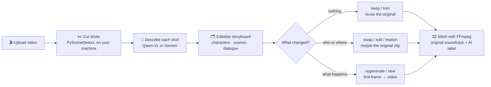

<p align="center">
  
</p>

<h1 align="center">Copy-Right</h1>

<p align="center">
  <b>Edit a finished video like a storyboard.</b><br/>
  Swap a character, change a scene, rewrite the plot, and regenerate <i>only the shots that changed</i>.
</p>

<p align="center">
  <b>English</b> · <a href="README.zh-CN.md">简体中文</a>
</p>

<p align="center">
  <a href="https://github.com/zhcalvin/copy-right/actions/workflows/ci.yml"></a>
  <a href="LICENSE"></a>
  
  
  
</p>

<p align="center">
  
</p>

<p align="center">
  <sub>Left: the original. Right: the presenter swapped for our sheep mascot. Audience shots are reused frame for frame, and the soundtrack is untouched.<br/>
  <a href="docs/assets/demo/compare.mp4">▶ Watch the MP4 with sound</a></sub>
</p>

---

## What happened in that clip

Copy-Right cut the 21-second segment into 6 shots, then picked the **lightest treatment** for each one:

| Shot | What's in it | Treatment | How |
| --- | --- | --- | --- |
| s007 | Presenter, heroic pose | 🔁 **swap** | The character is replaced, and the original motion, camera move and lighting are kept (Wan 2.2 Animate) |
| s008 · s009 · s011 | Audience reactions | ✅ **keep** | The original clip is reused unchanged, at no cost |
| s010 | Close-up, taking off sunglasses | ✨ **regenerate** | Too close for a swap, so: edit the first frame (Qwen-Image), then animate it from the shot's description (Wan 2.6 image-to-video) |
| s012 | Presenter, medium shot | 🔁 **swap** | Same as s007 |

<table>
  <tr>
    <td align="center"><b>The new character</b><br/><sub>made from our logo with one image edit</sub></td>
    <td align="center"><b>Before → after, one frame per changed shot</b></td>
  </tr>
  <tr>
    <td align="center" valign="top"></td>
    <td align="center"></td>
  </tr>
</table>

This demo was produced with [`scripts/make_demo.py`](scripts/make_demo.py) using the same adapters
the app uses. The generation and stitching UI arrives in M4 (see the [roadmap](#roadmap)).

## How it works



- **The original clip is the source of truth.** Each shot keeps its own clip and keyframes, so
  anything you don't touch comes back frame for frame.
- **Shot timing is exact.** Cuts are found locally, so the model never guesses timestamps.
- **You only pay for what changed.** Treatments run from lightest to heaviest:
  `keep → trim → swap → edit → motion → regenerate` (plus `new` and `removed`).

## The storyboard

<p align="center">
  
</p>

Upload a video and Copy-Right turns it into shot cards:

- **Hover** a card to play its clip.
- **Each card** shows the shot size, camera move, description and on-screen dialogue.
- **Click a character or scene** to highlight every shot it appears in.

The 85-second test clip came back as **47 shots, 15 characters and 3 scenes** in about 3–4 minutes.

<details>
<summary>More screenshots</summary>

| Highlight one character | 简体中文 UI |
| --- | --- |
|  |  |
| **Upload, with a rights confirmation** | **Parsing progress** |
|  |  |
| **First-run setup: pick a preset** | **Setup: test your keys (free calls only)** |
|  |  |
| **Setup: one row per capability** | **Settings → Models & keys** |
|  |  |

</details>

## Bring your own AI providers

Everything goes through pluggable adapters for 8 capabilities: video understanding, text,
image edit, video edit, image-to-video, voice-over, lip-sync and speech recognition. Pick a
preset, or mix providers per capability:

| Preset | Providers |
| --- | --- |
| 🇨🇳 China | Alibaba Cloud Model Studio (Qwen, Wan), Volcengine Ark, Kling, MiniMax |
| 🌍 Global | Google Gemini, Runway, fal.ai, ElevenLabs, Sync Labs |
| 🧪 Demo | Built-in mock adapters, no keys needed |

**Working today with real APIs:**

| Provider | Capabilities |
| --- | --- |
| Alibaba Cloud Model Studio | video understanding, image edit, character swap, image-to-video |
| Google Gemini | video understanding (adapter written; not yet run against a live account) |

**Your keys stay yours.** They live only on your machine, encrypted at rest with a master key in the
system keychain. After saving, the app only ever shows the last 4 characters. Environment
variables take priority over saved keys; see [`.env.example`](.env.example). "Test connection"
only calls free, read-only endpoints.

## Quick start

You need Python 3.11+, [uv](https://docs.astral.sh/uv/), [Bun](https://bun.sh) and
[FFmpeg](https://ffmpeg.org) on your `PATH`.

```bash
git clone https://github.com/zhcalvin/copy-right.git && cd copy-right

# Backend on http://localhost:8000
uv sync
uv run uvicorn app.main:app --reload --port 8000

# Frontend on http://localhost:5173 (in a second terminal)
cd web && bun install && bun run dev
```

Open <http://localhost:5173>. The setup wizard walks you through providers and keys. Choose
**Demo** to try everything without any keys.

<details>
<summary>Tests and project layout</summary>

```bash
uv run pytest --cov=app          # backend, 80% coverage enforced in CI
uv run ruff check app tests
cd web && bun run build          # type-check and build the frontend
```

```text
app/
  api/             HTTP routes
  capabilities/    The 8 capability interfaces and request contracts
  providers/       registry.yaml (models, presets) + one adapter package per provider
  pipeline/        Parsing pipeline, job queue and worker
  storyboard/      Storyboard schema and treatment rules
  tools/           FFmpeg and PySceneDetect wrappers
web/               React + Vite + Tailwind frontend (English / 简体中文)
scripts/           make_demo.py, which built the clip above
docs/PLAN.md       Full design and milestone plan (Chinese)
```

</details>

## Roadmap

- [x] **M0** Skeleton: backend, frontend, job worker, capability interfaces, mock adapters
- [x] **M1** Setup wizard, encrypted keys, free connection tests, English / 简体中文 UI
- [x] **M2** Parsing: shot detection, clips, keyframes, AI storyboard (Qwen, Gemini)
- [ ] **M3** Storyboard editor, asset panel, natural-language plot edits, version history
- [ ] **M4** Generation and stitching in the app (adapters for swap, image edit and image-to-video are already in)
- [ ] **M5** Voice-over and lip-sync
- [ ] **M6** Remaining adapters, cost estimates, preview tiers

## Responsible use

Only upload footage you have the rights to, including the likeness rights of the people in it.
Copy-Right asks you to confirm this on every upload. Exported videos carry a visible
"AI-generated" label. Check the AI-content labelling rules wherever you publish.

The demo uses a clip from bilibili creator @王与也行 (watermark visible). All edits are clearly
labelled as AI-generated.

## Contributing

Issues and pull requests are welcome. See [CONTRIBUTING.md](CONTRIBUTING.md).
If Copy-Right made you smile, a ⭐ helps other people find it.

## License

[MIT](LICENSE)
