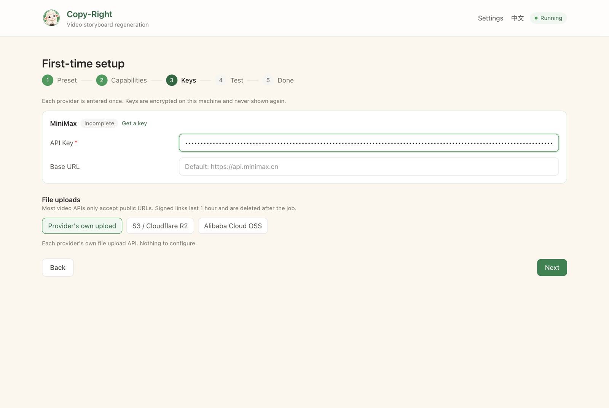
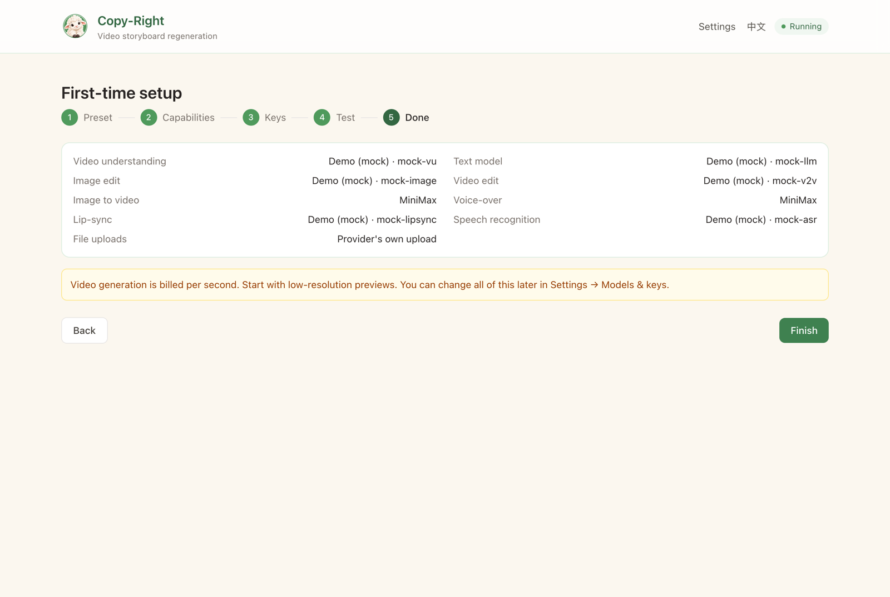

<p align="center">
  
</p>

<h1 align="center">Copy-Right</h1>

<p align="center">
  Turn an existing video into an editable storyboard. Swap characters or scenes, tweak the plot,<br/>
  and regenerate <b>only the shots that changed</b>.
</p>

<p align="center">
  <a href="README.zh-CN.md">简体中文</a> ·
  <a href="docs/PLAN.md">Design plan (中文)</a> ·
  <a href="LICENSE">MIT License</a>
</p>

> **Status: early development (M1 setup wizard).** The app runs end to end with mock providers,
> and the setup wizard can save and test real provider keys. Real generation adapters land in
> later milestones. See [Roadmap](#roadmap).

<p align="center">
  
</p>

## How it works

1. **Upload** a video (up to 3 minutes / 30 shots).
2. **Parse**: shots are detected with PySceneDetect, then a multimodal model writes a layered
   storyboard: narrative, visual, control, and asset references. Each shot keeps its
   original clip as the source of truth.
3. **Edit** the storyboard cards directly, or describe a plot change in natural language.
4. **Regenerate** each shot with the lightest treatment that fits the change:

   `keep → trim → swap → edit → motion → regenerate` (plus `new` and `removed`)

   Unchanged shots are reused frame for frame. Only what you touched costs money.
5. **Stitch** everything back into a new video with FFmpeg.

## Bring your own providers

All AI work goes through pluggable adapters for 8 capabilities: video understanding, LLM text,
image edit, video-to-video edit, image-to-video, TTS, lip-sync, and ASR. A first-run wizard lets
you pick a preset or mix providers per capability:

| Preset | Providers |
| --- | --- |
| China | Alibaba Cloud Model Studio (DashScope), Volcengine Ark, Kling, MiniMax |
| Global | Google Gemini, Runway, fal.ai, ElevenLabs, Sync Labs |
| Demo | Mock adapters, no keys needed |

Keys stay on your machine, encrypted at rest, and are never shown in full after you save them.
The master key lives in the system keychain (falling back to `data/master.key` when no keychain is
available). Environment variables such as `MINIMAX_API_KEY` take priority over saved keys; see
[`.env.example`](.env.example).

"Test connection" only calls free, read-only endpoints (list models, account info), so it never
triggers billable generation.

## Screenshots

| Choose a preset | Test connections |
| --- | --- |
|  |  |
| **Enter keys** | **Summary** |
|  |  |
| **Settings → Models & keys** | **简体中文 UI** |
|  |  |

The UI defaults to English. Switch to Simplified Chinese from the header; the choice is remembered
per browser.

## Quick start

Requirements: Python 3.11+, [uv](https://docs.astral.sh/uv/), [Bun](https://bun.sh), and
[FFmpeg](https://ffmpeg.org) on your `PATH`.

```bash
# Backend (http://localhost:8000)
uv sync
uv run uvicorn app.main:app --reload --port 8000

# Frontend (http://localhost:5173), in another terminal
cd web
bun install
bun run dev
```

Open <http://localhost:5173>.

### Tests

```bash
uv run pytest
uv run ruff check app tests
cd web && bun run build
```

## Project layout

```text
app/
  main.py            FastAPI entry point
  api/               HTTP routes
  capabilities/      The 8 capability interfaces (base.py)
  providers/         registry.yaml (models, presets) and one adapter package per provider
  storyboard/        Storyboard schema and treatment rules
  pipeline/          Job queue and worker
  core/              Config, database, encryption, secret masking
web/                 React + Vite + Tailwind frontend (i18n in web/src/i18n)
docs/PLAN.md         Full design and milestone plan
```

## Roadmap

- [x] **M0** Skeleton: backend, frontend, SQLite, job worker, capability interfaces, mock adapters, provider registry
- [x] **M1** Setup wizard, encrypted credentials, connection tests, settings page, English / 简体中文 UI
- [ ] **M2** Parsing: shot detection, clips, keyframes, storyboard generation (Bailian + Gemini)
- [ ] **M3** Storyboard editor, asset panel, natural-language plot edits, version history
- [ ] **M4** Generation and stitching
- [ ] **M5** Dubbing and lip-sync
- [ ] **M6** Remaining adapters, cost estimates, preview tiers

## Responsible use

Only upload footage you have the rights to, including the likeness rights of the people in it.
Exported videos carry a visible "AI-generated" label and metadata by default. Check the
AI-content labeling rules wherever you publish.

## Contributing

See [CONTRIBUTING.md](CONTRIBUTING.md).

## License

[MIT](LICENSE)
