<p align="center">
  
</p>

<h1 align="center">Copy-Right</h1>

<p align="center">
  <b>像改分镜一样改一段成片。</b><br/>
  换人、换场景、改剧情，<i>只重新生成改动过的镜头</i>。
</p>

<p align="center">
  <a href="README.md">English</a> · <b>简体中文</b>
</p>

<p align="center">
  <a href="https://github.com/zhcalvin/copy-right/actions/workflows/ci.yml"></a>
  <a href="LICENSE"></a>
  
  
  
</p>

<p align="center">
  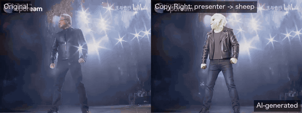
</p>

<p align="center">
  <sub>左：原片。右：演讲者换成了我们的小羊吉祥物。观众镜头逐帧沿用原片，背景音乐保持不变。<br/>
  <a href="docs/assets/demo/compare.mp4">▶ 观看带声音的 MP4</a></sub>
</p>

---

## 这段视频里发生了什么

Copy-Right 把这 21 秒切成 6 个镜头，再给每个镜头选**最轻的处理方式**：

| 镜头 | 画面内容 | 处理方式 | 做法 |
| --- | --- | --- | --- |
| s007 | 演讲者摆出英雄姿势 | 🔁 **替换（swap）** | 只换人物，保留原片的动作、运镜和光线（万相 2.2 Animate） |
| s008 · s009 · s011 | 观众反应 | ✅ **沿用（keep）** | 直接使用原片，不产生费用 |
| s010 | 摘墨镜的特写 | ✨ **重新生成（regenerate）** | 特写太近，无法直接替换：先用通义千问图像编辑改首帧，再按镜头描述用万相 2.6 图生视频 |
| s012 | 演讲者中景 | 🔁 **替换（swap）** | 同 s007 |

<table>
  <tr>
    <td align="center"><b>新角色</b><br/><sub>用一次图像编辑从项目标志生成</sub></td>
    <td align="center"><b>改动前 → 改动后（每个改动镜头取一帧）</b></td>
  </tr>
  <tr>
    <td align="center" valign="top"></td>
    <td align="center">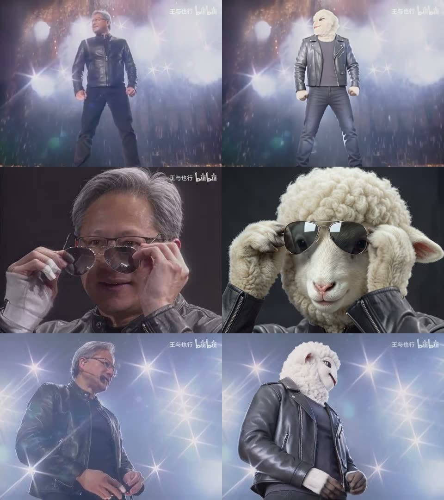</td>
  </tr>
</table>

这段演示由 [`scripts/make_demo.py`](scripts/make_demo.py) 生成，用的是应用本身的适配器。
应用内的生成与合成界面会在 M4 上线（见[路线图](#路线图)）。

## 工作原理

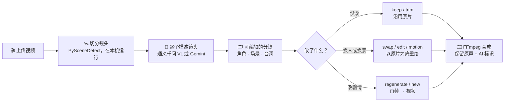

- **原片段是事实来源。** 每个镜头都保留自己的片段和关键帧，没改的地方逐帧还原。
- **镜头时间点精确到帧。** 切点在本机检测，不靠模型去猜时间戳。
- **只为改动付费。** 处理方式由轻到重：`keep → trim → swap → edit → motion → regenerate`（另有 `new`、`removed`）。

## 分镜板

<p align="center">
  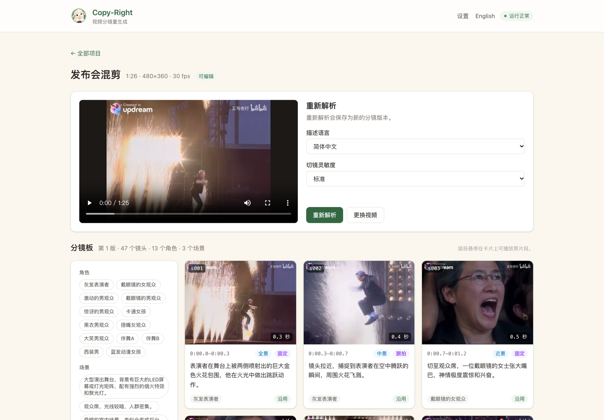
</p>

上传视频后，Copy-Right 会把它变成一张张镜头卡片：

- **鼠标悬停**在卡片上可播放该镜头的原片段。
- **每张卡片**显示景别、运镜、画面描述和屏幕上的台词。
- **点击一个角色或场景**，会高亮它出现的所有镜头。

85 秒的测试视频解析出 **47 个镜头、13 个角色、3 个场景**，用时约 3–4 分钟。

<details>
<summary>更多截图</summary>

| 高亮某个角色 | English UI |
| --- | --- |
| 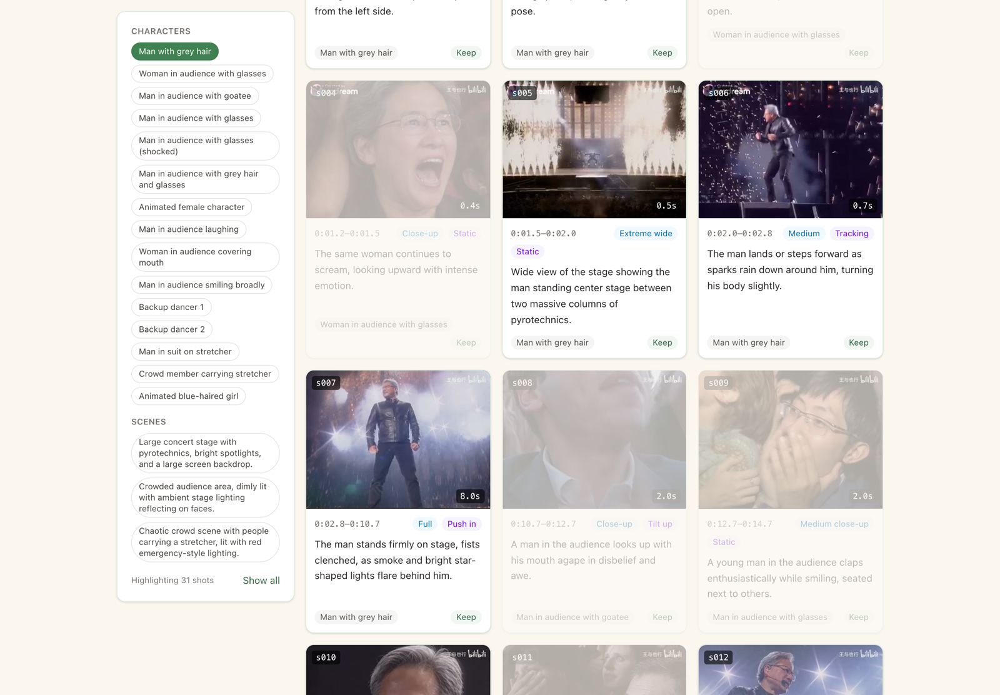 | 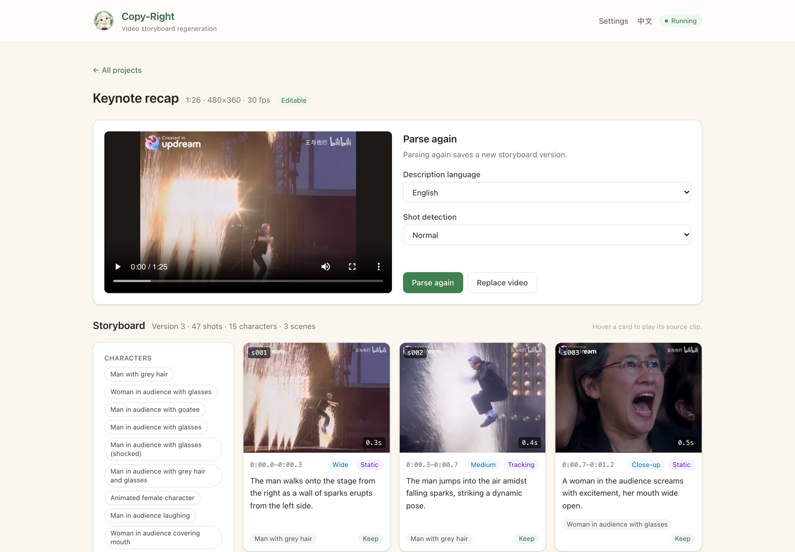 |
| **上传时确认素材权利** | **解析进度** |
| 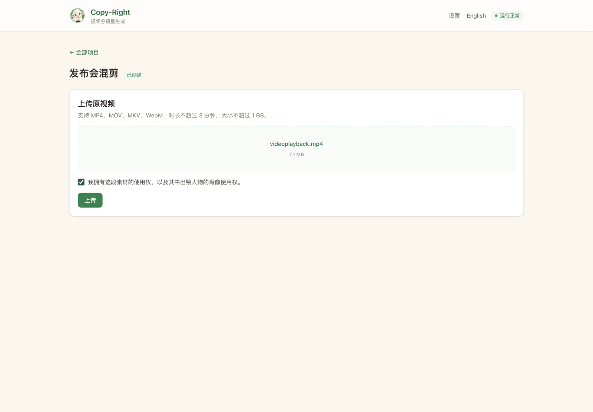 | 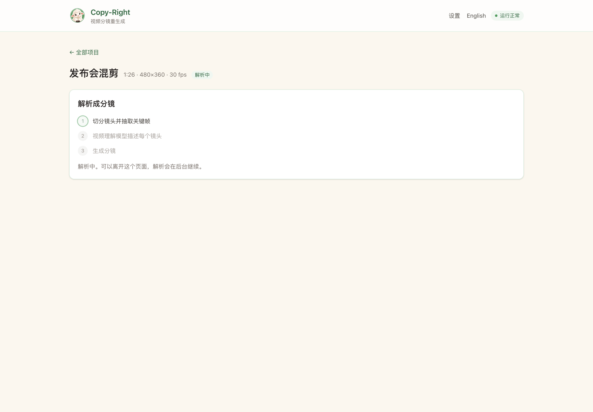 |
| **首次启动：选择套餐** | **测试 key（只调用免费接口）** |
| 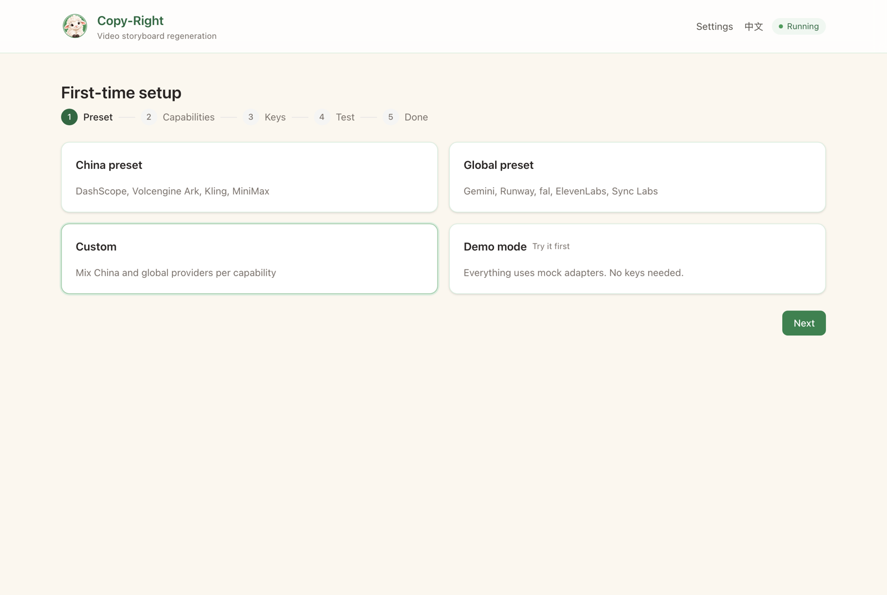 | 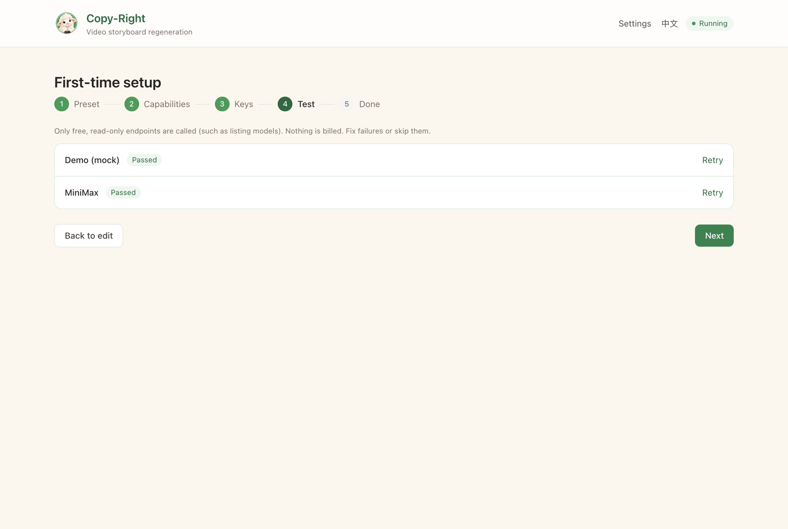 |
| **按能力选择供应商** | **设置 → 模型与密钥** |
| 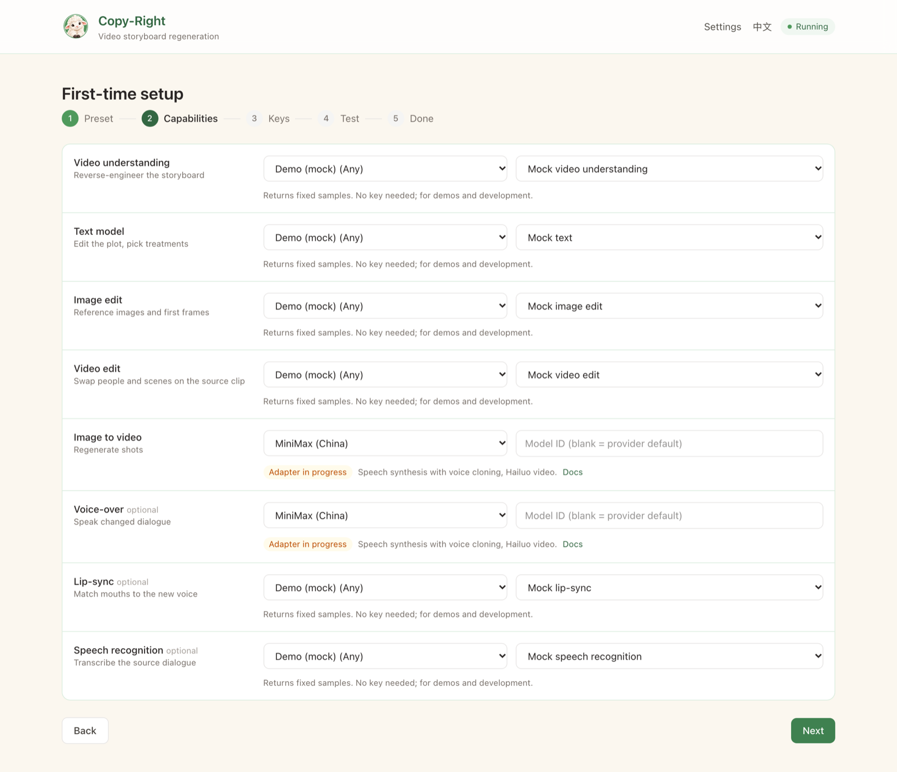 | 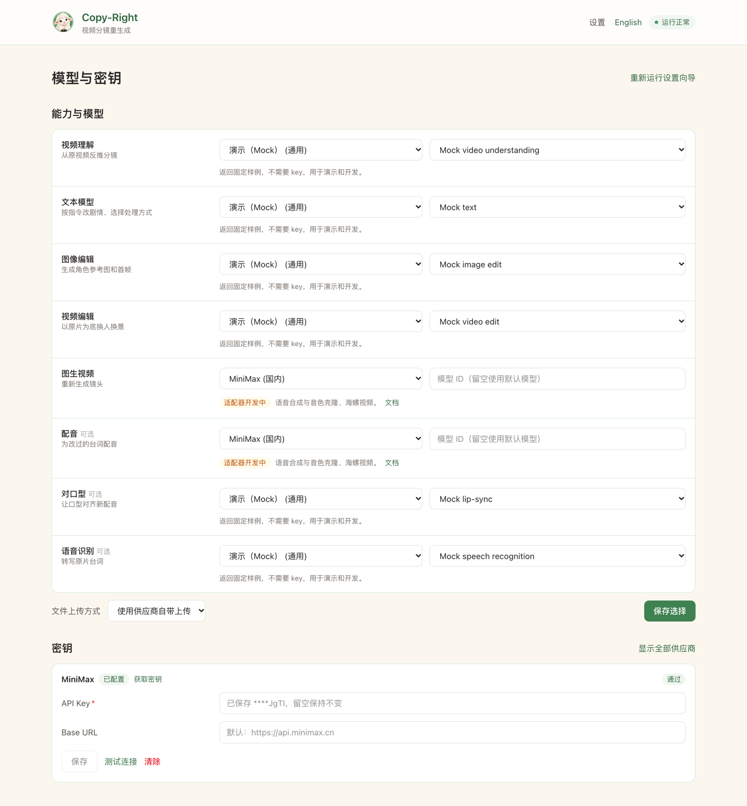 |

</details>

## 自带 AI 供应商

所有 AI 能力都通过可插拔的适配器接入，共 8 个能力：视频理解、文本、图像编辑、视频编辑、图生视频、配音、对口型、语音识别。
你可以直接选一个套餐，也可以按能力混用不同供应商：

| 套餐 | 供应商 |
| --- | --- |
| 🇨🇳 国内 | 阿里云百炼（通义千问、通义万相）、火山方舟、可灵、MiniMax |
| 🌍 海外 | Google Gemini、Runway、fal.ai、ElevenLabs、Sync Labs |
| 🧪 演示 | 内置 mock 适配器，不需要任何 key |

**目前已接通真实 API：**

| 供应商 | 能力 |
| --- | --- |
| 阿里云百炼 | 视频理解、图像编辑、角色替换、图生视频 |
| Google Gemini | 视频理解（适配器已写好，尚未用真实账号跑通） |

**key 只在你自己手里。** key 只保存在你的电脑上，静态加密存储，主密钥放在系统钥匙串。保存后界面只显示末 4 位。
环境变量优先于已保存的 key，详见 [`.env.example`](.env.example)。"测试连接"只调用免费的只读接口。

## 快速开始

需要 Python 3.11+、[uv](https://docs.astral.sh/uv/)、[Bun](https://bun.sh)，并把 [FFmpeg](https://ffmpeg.org) 加到 `PATH`。

```bash
git clone https://github.com/zhcalvin/copy-right.git && cd copy-right

# 后端：http://localhost:8000
uv sync
uv run uvicorn app.main:app --reload --port 8000

# 前端：http://localhost:5173（另开一个终端）
cd web && bun install && bun run dev
```

打开 <http://localhost:5173>，设置向导会带你选择供应商、填写 key。想先体验？选**演示**套餐，不需要任何 key。
界面默认英文，可在顶部切换为简体中文。

<details>
<summary>测试与目录结构</summary>

```bash
uv run pytest --cov=app          # 后端测试，CI 要求覆盖率 ≥ 80%
uv run ruff check app tests
cd web && bun run build          # 前端类型检查并构建
```

```text
app/
  api/             HTTP 路由
  capabilities/    8 个能力接口与请求约定
  providers/       registry.yaml（模型、套餐）+ 每个供应商一个适配器包
  pipeline/        解析流水线、任务队列与 worker
  storyboard/      分镜 schema 与处理方式规则
  tools/           FFmpeg 与 PySceneDetect 封装
web/               React + Vite + Tailwind 前端（English / 简体中文）
scripts/           make_demo.py，上面的演示视频就是用它做的
docs/PLAN.md       完整设计与里程碑
```

</details>

## 路线图

- [x] **M0** 骨架：后端、前端、任务 worker、能力接口、mock 适配器
- [x] **M1** 设置向导、key 加密存储、免费的连接测试、中英文界面
- [x] **M2** 解析：切镜、切片、关键帧、AI 生成分镜（通义千问、Gemini）
- [ ] **M3** 分镜编辑器、资产面板、自然语言改剧情、版本历史
- [ ] **M4** 应用内生成与合成（替换、图像编辑、图生视频的适配器已就绪）
- [ ] **M5** 配音与对口型
- [ ] **M6** 补齐其余适配器、费用预估、预览档位

## 合规使用

只上传你有权使用的素材，包括画面中人物的肖像权。每次上传时 Copy-Right 都会要求你确认这一点。
导出的视频默认带有可见的"AI 生成"标识。发布前请遵守当地关于 AI 生成内容标识的规定，例如中国大陆的《人工智能生成合成内容标识办法》。

演示片段来自 bilibili 创作者 @王与也行（画面中可见水印），所有改动处都标明了 AI 生成。

## 参与贡献

欢迎提 Issue 和 Pull Request，详见 [CONTRIBUTING.md](CONTRIBUTING.md)。
如果 Copy-Right 让你会心一笑，点个 ⭐ 能帮更多人发现它。

## 许可证

[MIT](LICENSE)
