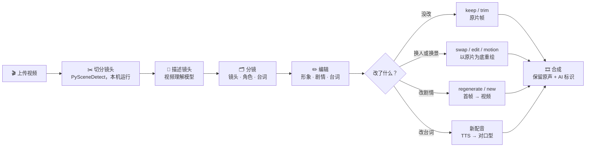
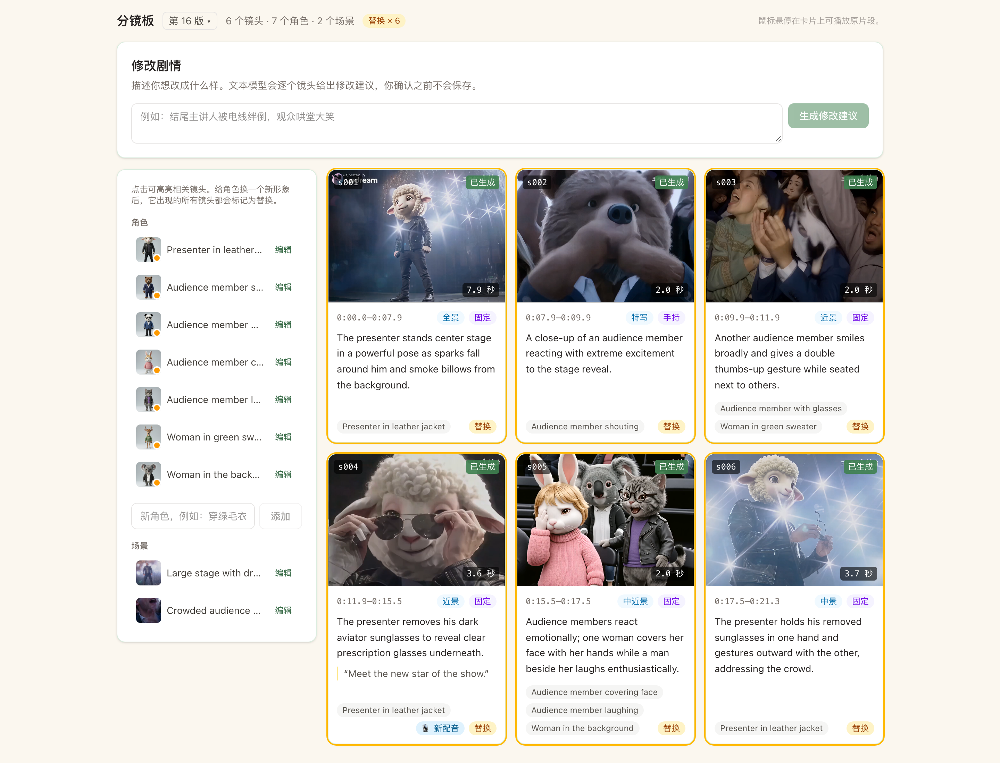
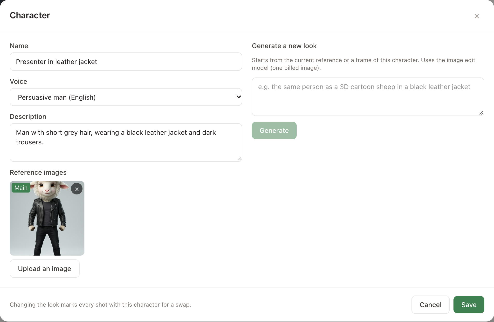
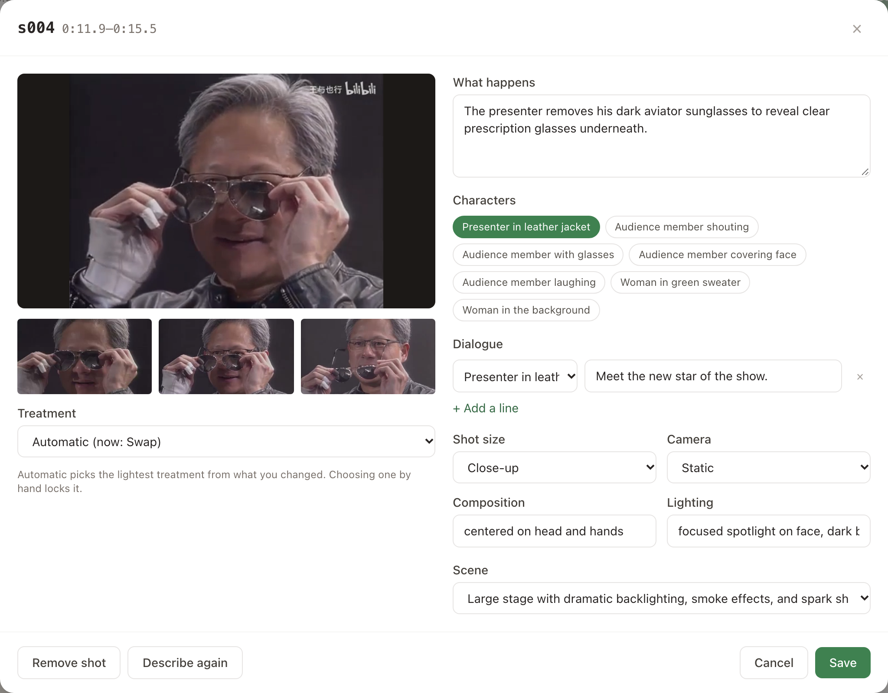
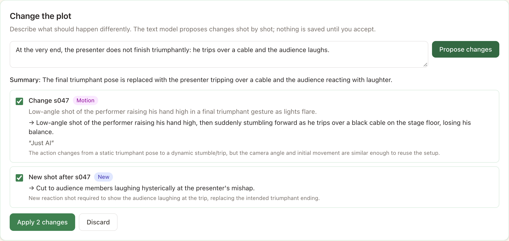
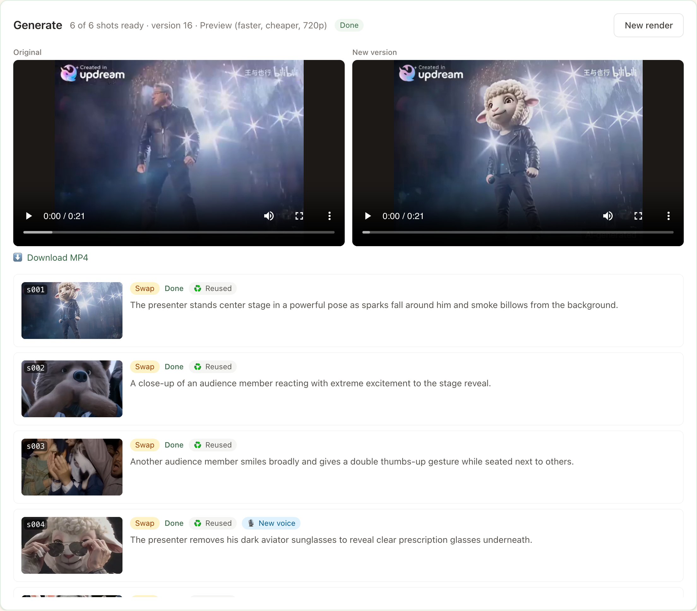
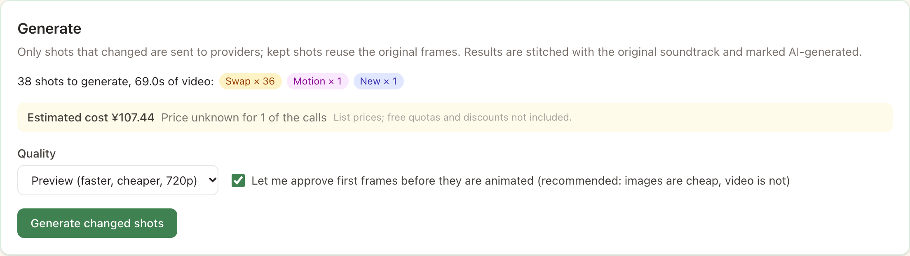
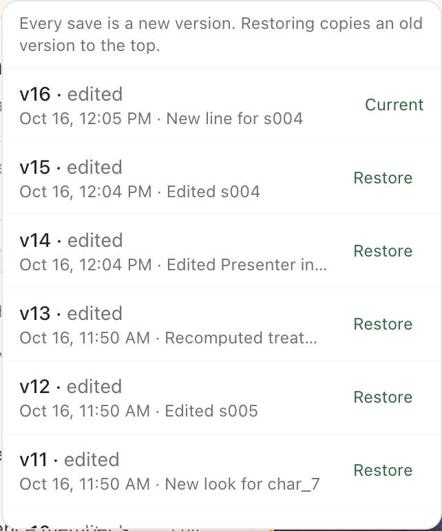
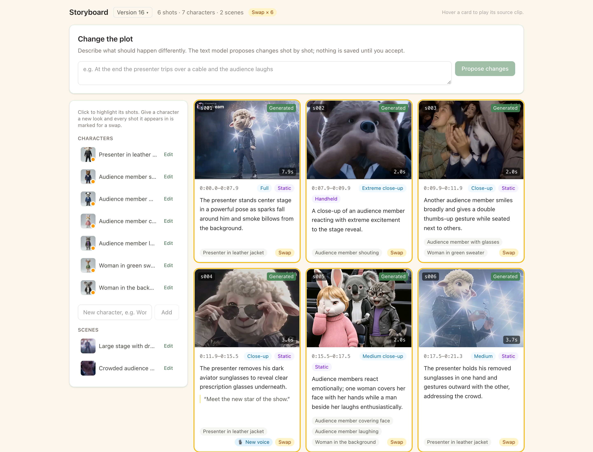

<p align="center">
  
</p>

<h1 align="center">Copy-Right</h1>

<p align="center">
  <b>像改分镜一样改一段成片。</b><br/>
  给每个角色换人、改台词、改剧情，<i>只重新生成改动过的镜头</i>。
</p>

<p align="center">
  <a href="README.md">English</a> · <b>简体中文</b>
</p>

<p align="center">
  <a href="https://github.com/zhcalvin/copy-right/actions/workflows/ci.yml"></a>
  <a href="LICENSE"></a>
  
  
  
</p>

<p align="center">
  
</p>

<p align="center">
  <sub>左：原片。右：同一段 21 秒视频，画面里的 7 个人全部换了形象，全程在应用里完成。<br/>
  <a href="docs/assets/demo/compare.mp4">▶ 观看带声音的 MP4</a>（0:12 处小羊说了一句新台词）</sub>
</p>

---

## 这段视频里发生了什么

Copy-Right 把这段视频切成 6 个镜头，识别出 7 个人物。每个人只用一张参考图换了新形象，其中一个镜头还加了一句新台词。其余一切都来自原片：

<p align="center">
  
</p>

| 步骤 | 在应用里 | 背后发生了什么 |
| --- | --- | --- |
| **1. 解析** | 上传视频，点“解析” | 在本机切镜头（PySceneDetect）；通义千问 VL 描述每个镜头，并把同一个人在不同镜头里对应起来 |
| **2. 换角色** | 编辑角色 → 上传或生成新形象 | 所有出现这个角色的镜头都标记为 🔁 **替换** |
| **3. 补上配角** | “添加角色”，在镜头里勾选 | 解析时漏掉的人也能换 |
| **4. 新台词** | 在镜头编辑里写一句台词，选个音色 | 镜头标记为 🎙 **新配音**，画面不用重新生成 |
| **5. 生成** | 先看费用预估，再点“生成” | 通义万相 2.7 视频编辑按参考图重绘每个镜头，保留动作、运镜和节奏；MiniMax 配音；VideoRetalk 对口型 |
| **6. 合成** | 对比原片和新片，下载 | 片段统一规格，生成的镜头标注“AI-generated”，保留原声（新台词处原声自动压低） |

<p align="center">
  
  <br/><sub>每个镜头的改动前 → 改动后。特写和人群镜头也没问题：一次编辑就能同时替换好几个人。</sub>
</p>

加台词的第二次生成**直接沿用了第一次的 6 个画面**，只为配音和对口型付费：约 1 分钟，而第一次用了约 10 分钟。

## 工作原理



- **原片段是事实来源。** 每个镜头都保留自己的片段和关键帧，没改的地方逐帧还原，时间轴不会漂移。
- **处理方式由轻到重：** `keep → trim → swap → edit → motion → regenerate`（另有 `new`、`removed`），按你改动的层自动选择，也可以逐个镜头手动锁定。
- **同样的东西只付一次钱。** 每个生成的镜头都记得自己用了哪些输入。之后再生成时，输入没变的镜头直接沿用，费用预估也按免费计算。
- **先图后视频。** 需要重新生成的镜头，先确认便宜的首帧，再生成昂贵的视频。

## 编辑器

<p align="center">
  
</p>

<table>
  <tr>
    <td width="50%"><br/><sub><b>角色。</b>上传形象，或用图像模型生成；选择音色。</sub></td>
    <td width="50%"><br/><sub><b>镜头。</b>修改任意一层、锁定处理方式、添加台词，或重新解析这个镜头。</sub></td>
  </tr>
  <tr>
    <td><br/><sub><b>改剧情。</b>“结尾他被电线绊倒”：文本模型逐个镜头给出修改建议，附处理方式和理由，你逐条确认。</sub></td>
    <td><br/><sub><b>生成。</b>逐镜头实时进度；可以重试（被审核拒绝时可换供应商）；原片与新片对比。</sub></td>
  </tr>
  <tr>
    <td><br/><sub><b>先看费用。</b>扣费之前按官方原价估算（图中是给整段 85 秒视频换人）。</sub></td>
    <td><br/><sub><b>版本。</b>每次保存都是一个新版本，随时可以恢复。</sub></td>
  </tr>
</table>

<details>
<summary>更多截图（设置向导、设置页、English UI）</summary>

| English UI | 解析进度 |
| --- | --- |
|  |  |
| **首次启动：选择套餐** | **测试 key（只调用免费接口）** |
|  |  |
| **按能力选择供应商** | **设置 → 模型与密钥** |
|  |  |

</details>

## 自带 AI 供应商

所有 AI 能力都通过可插拔的适配器接入，共 8 个能力。可以直接选套餐，也可以按能力混用供应商；内置的**演示**套餐不需要任何 key，用 mock 跑通完整流程。

| 能力 | 🇨🇳 国内套餐 | 🌍 海外套餐 |
| --- | --- | --- |
| 视频理解 | 阿里云百炼（通义千问 VL）✅ | Gemini |
| 文本（改剧情） | 百炼（通义千问）✅ | Gemini |
| 图像编辑 | 百炼（通义千问图像）✅ | Gemini 图像模型 |
| 视频编辑（替换、编辑、动作迁移） | 百炼（万相 2.7 视频编辑、万相 Animate）✅ | Runway（Gemini Omni、Aleph） |
| 图生视频 | 可灵（或万相 2.6 ✅） | Gemini（Veo 3.1） |
| 配音 | MiniMax ✅ | ElevenLabs |
| 对口型 | 百炼（VideoRetalk）✅ | Sync Labs |

✅ = 开发时已用真实 API 跑通。其余适配器按各家最新 API 文档编写，并用模拟 HTTP 的测试覆盖，但还没有用真实 key 跑过。欢迎反馈和提交修复。

**key 只在你自己手里。** key 只保存在你的电脑上，用系统钥匙串里的主密钥加密；界面只显示末 4 位。环境变量优先于已保存的 key，详见 [`.env.example`](.env.example)。“测试连接”只调用免费的只读接口。

## 快速开始

需要 Python 3.11+、[uv](https://docs.astral.sh/uv/)、[Bun](https://bun.sh)，并把 [FFmpeg](https://ffmpeg.org) 加到 `PATH`。

```bash
git clone https://github.com/zhcalvin/copy-right.git && cd copy-right

# 后端：http://localhost:8000
uv sync
uv run uvicorn app.main:app --reload --port 8000

# 前端：http://localhost:5173（另开一个终端）
cd web && bun install && bun run dev
```

打开 <http://localhost:5173>，设置向导会带你选择供应商、填写 key。想先体验？选**演示**套餐，不需要任何 key（生成结果是变色的原片，方便看出哪里改了）。界面默认英文，可在顶部切换为简体中文。

<details>
<summary>测试与目录结构</summary>

```bash
uv run pytest --cov=app          # 后端测试，CI 要求覆盖率 ≥ 80%
uv run ruff check app tests
cd web && bun run build          # 前端类型检查并构建
```

```text
app/
  api/             HTTP 路由
  capabilities/    8 个能力接口与请求约定
  providers/       registry.yaml（模型、价格、音色、套餐）+ 每个供应商一个适配器
  pipeline/        解析、改剧情、资产、生成与合成、费用预估、任务 worker
  storyboard/      分镜 schema、版本、改动层对比与处理方式规则
  tools/           FFmpeg 与 PySceneDetect 封装
web/               React + Vite + Tailwind 前端（English / 简体中文）
scripts/           demo_assets.py，用一次已完成的生成结果制作上面的演示
docs/PLAN.md       完整设计与里程碑
```

</details>

## 路线图

- [x] **M0** 骨架：后端、前端、任务 worker、能力接口、mock 适配器
- [x] **M1** 设置向导、key 加密存储、免费的连接测试、中英文界面
- [x] **M2** 解析：切镜、切片、关键帧、AI 生成分镜
- [x] **M3** 分镜编辑器、角色形象、自然语言改剧情、版本历史
- [x] **M4** 生成与合成：全部处理方式、首帧确认、重试、AI 标识
- [x] **M5** 配音与对口型、跨次生成复用结果
- [x] **M6** 费用预估、预览 / 终版画质、单镜头重新解析、两套预设的全部适配器

接下来：用真实账号跑通海外套餐；为只接受 URL 的供应商（可灵对口型、fal）接入对象存储；补上火山方舟和 fal 的适配器。

## 合规使用

只上传你有权使用的素材，包括画面中人物的肖像权。每次上传时 Copy-Right 都会要求你确认这一点。生成的镜头带有可见的“AI-generated”标识，文件里也写入了 AI 生成元数据。发布前请遵守当地关于 AI 生成内容标识的规定，例如中国大陆的《人工智能生成合成内容标识办法》。

演示片段来自 bilibili 创作者 @王与也行（画面中可见水印），所有改动处都标明了 AI 生成。

## 参与贡献

欢迎提 Issue 和 Pull Request，详见 [CONTRIBUTING.md](CONTRIBUTING.md)。
如果 Copy-Right 让你会心一笑，点个 ⭐ 能帮更多人发现它。

## 许可证

[MIT](LICENSE)
