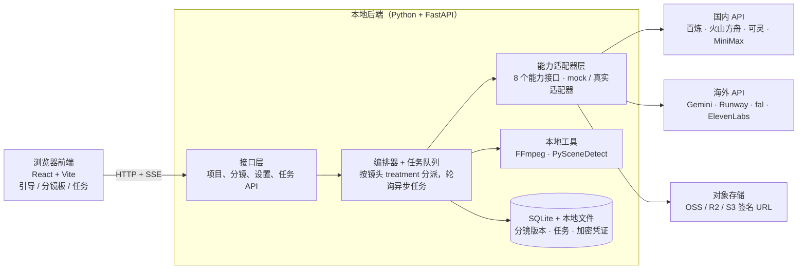
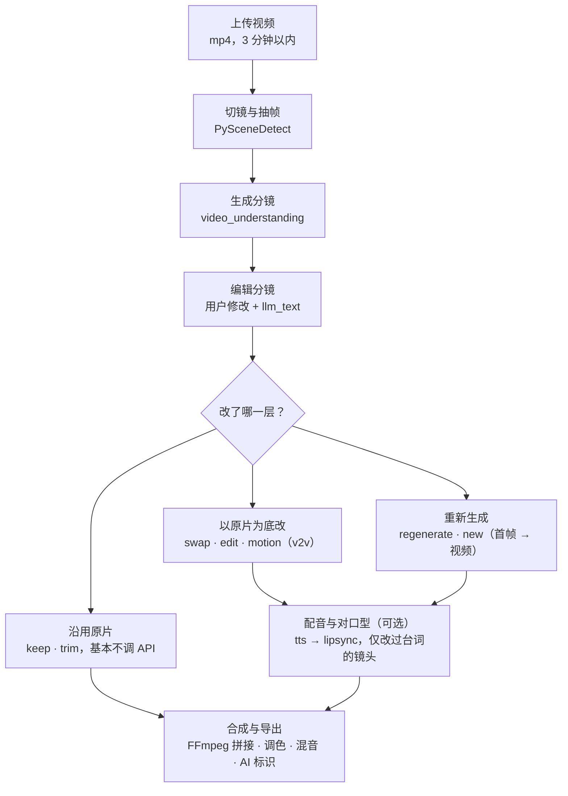

# 视频分镜重生成应用：可插拔 API 方案与实施计划

> 本文整理自与 Claude 的规划对话（2026-10），包含背景、关键决策和完整实施计划。
> 供本地 agent（Claude Code）按里程碑执行。项目目录：`~/Projects/copy`。

---

## 0. 背景与关键决策（对话摘要）

### 0.1 产品目标

从一段已有视频反推出分镜（storyboard），用户可以替换人物、场景，或修改少量剧情，然后只重新生成受影响的镜头，合成新视频。

### 0.2 技术路线是怎么定下来的

1. **最初方案：自部署开源模型。** 包括 PySceneDetect/TransNetV2 切镜、Qwen-VL 理解、SAM 2 分割、DWPose/Depth Anything 控制信号、Wan VACE / Wan-Animate 换人、Wan/Hunyuan 图生视频、CosyVoice 配音、LatentSync 对口型，用 ComfyUI 编排。结论：效果可控，但部署和维护太重。
2. **轻量化：以 API 为主。** 理解层用多模态大模型 API，生成层用商用视频 API，商用 API 覆盖不到的再用托管开源模型（fal.ai、Replicate、阿里百炼上的 Wan 系列）补齐。自己只维护 CPU 级小工具（PySceneDetect、FFmpeg）。
3. **国内与海外两套 + 每步可选。** 定义统一的能力接口，每个供应商写一个适配器。首次打开时在浏览器里引导用户选择套餐（国内 / 海外 / 自定义）、选模型、填 key。
4. **为什么不直接用 Wan 换人换景。** 只换单个短片段时，直接用 Wan 就够了。但遇到以下情况需要分镜层：
   - 长视频、多镜头
   - 跨镜头角色一致性
   - 改剧情（Wan 的视频到视频只能沿用原动作）
   - 只重生成受影响的镜头以控制成本
   - 台词和配音
   - 用户需要看得懂、能确认的编辑界面

   结论：分镜是编排层，Wan 是执行引擎之一。
5. **分镜作为中间表示。** 解析结果本身就是一份分镜，原视频是它的一种"渲染结果"：改分镜，再重新渲染。纯文字分镜会丢信息（表演细节、运镜节奏、构图、光线、声音），因此采用**分层分镜**。
6. **原片段作为事实来源。** 每个镜头保存原片段，结构化字段是对它的解读和可编辑的索引。这样带来三个好处：
   - 信息不再有损。
   - 解析可以按需进行，出错可以重新解析。
   - 生成时，原片段可以按改动大小作为驱动、底片或参考。

   由此得到由轻到重的**处理方式光谱**：keep → trim → swap → edit → motion → regenerate。系统自动选择最轻的一档。

### 0.3 可参考的开源项目

开源项目大多是"正向"的，即从想法或剧本生成分镜，再生成视频。"从视频反推分镜"的成熟项目基本没有。反推部分自己写（PySceneDetect 加一次多模态模型调用加 schema 校验，约几百行），生成和界面可以参考下面这些项目：

| 项目 | 价值 | 备注 |
| --- | --- | --- |
| [HKUDS/ViMax](https://github.com/HKUDS/ViMax) | 多 agent 正向流水线：编剧、分镜、角色一致性、首尾帧生成视频、VLM 质检择优；已接入 Veo、Seedance | MIT；研究代码，无编辑界面，重生成是整片重做 |
| [Swapnil-bo/CutAI](https://github.com/Swapnil-bo/CutAI) | 分镜画布和镜头面板界面、镜头字段设计、JSON/PDF 导出 | 复用代码前确认许可证 |
| [t0moon/smartvideo](https://github.com/t0moon/smartvideo) | LangGraph 编排、可插拔视频供应商、基于已有分镜只重跑部分步骤 | 架构参考 |
| video-analyzer（MCP） | 反推方向：场景检测、Whisper 转写、视觉模型逐帧描述，输出分镜文档 | 很小，只看思路 |

---

## 1. 目标与范围

做一个本地运行的 Web 应用。流程是：上传视频，自动反推出可编辑的分镜；用户替换人物、场景或改动少量剧情后，只重新生成受影响的镜头，再合成新视频。

所有 AI 能力都走第三方 API，每一步的供应商都可选。首次打开时，在浏览器里引导用户选套餐（国内 / 海外 / 自定义）并填写 key。

**第一版要做**

- 单用户、本地运行（`localhost`），数据存本机。
- 视频长度先支持到 3 分钟以内、30 个镜头以内。
- 镜头级的处理方式，见第 6 节的处理方式光谱。
- 配音和对口型作为可选步骤。

**第一版不做**

- 多用户、账号体系、计费。
- 自己部署 GPU 模型。只留一个"自定义 HTTP / ComfyUI 端点"的扩展口。
- 复杂时间线剪辑，比如转场特效、多轨混剪。

**给本地 agent 的执行原则**

1. 按第 9 节"里程碑"顺序实现，每个里程碑满足验收标准后再进入下一个。
2. **不要硬编码模型名和接口地址。** 本文列出的供应商和模型是 2026 年中的情况。实现每个适配器前，先查该供应商官方文档，确认当前的模型 ID、接口路径、鉴权方式和输入限制，再写进供应商注册表配置。
3. 每个能力都先实现一个 `mock` 适配器（返回固定样例）。这样不填任何 key 也能跑通整条流程和 UI。
4. 所有对外请求统一经过适配器层，业务代码不直接调用任何供应商 SDK。

---

## 2. 总体架构

一个浏览器前端加一个本地 Python 后端，不需要 GPU。后端里只有适配器层会访问外部 API。



编排器按每个镜头的 `treatment` 决定调用哪些能力。适配器层把请求翻译成具体供应商的接口；需要公网 URL 的输入，先传到对象存储。

**技术栈**

- 后端：Python 3.11+、FastAPI、SQLModel + SQLite。任务队列用进程内 worker，任务状态持久化在 SQLite，重启后可恢复，不需要 Redis。
- 前端：React + Vite + TypeScript + Tailwind；任务进度用 SSE 推送。
- 媒体：系统需安装 FFmpeg；Python 依赖 `scenedetect`、`keyring`、`cryptography`、`httpx`。
- 启动：后端 `uv run uvicorn app.main:app --reload`，前端 `cd web && npm run dev`。

**目录结构**

```text
app/
  main.py           # FastAPI 入口（lifespan 中 init_db + 启动 worker）
  api/              # FastAPI 路由
  core/             # 配置、数据库、加密、日志脱敏
  models.py         # SQLite 表
  pipeline/         # 解析、编辑、生成、合成的编排逻辑 + worker
  capabilities/     # 8 个能力的接口定义（base.py）
  storyboard/       # 分镜 schema、treatment 选择规则、样例
  providers/
    registry.yaml   # 供应商、模型、凭证字段、预设套餐
    registry.py     # 加载注册表、构造适配器
    mock/
    dashscope/      # 阿里云百炼
    volcengine/     # 火山方舟
    kling/
    minimax/
    gemini/
    runway/
    fal/
    elevenlabs/
    synclabs/
  storage/          # 本地文件 + OSS / R2 / S3
  tools/            # ffmpeg、scenedetect 封装
web/                # 前端
data/projects/<id>/ # 源视频、切片、关键帧、结果
tests/
```

---

## 3. 能力抽象层

整个系统只认 8 个能力接口和 2 个本地工具。每个供应商实现其中若干个接口，用户在设置里为每个能力选一个供应商和模型。

| 能力 ID | 作用 | 输入 | 输出 | 调用方式 |
| --- | --- | --- | --- | --- |
| `video_understanding` | 视频 → 分镜描述；也用于单镜头按需重新解析 | 视频（URL 或文件）、镜头切点、schema | 分镜 JSON | 同步或长轮询 |
| `llm_text` | 按指令修改剧情、改写镜头描述、生成提示词、判断 treatment | 分镜 JSON、用户指令 | 修改后的 JSON + 受影响镜头列表 | 同步 |
| `image_edit` | 角色多角度参考图、替换后的关键帧、场景图 | 参考图（1–N 张）、原关键帧、提示词 | 图片 | 同步或异步 |
| `video_edit_v2v` | 以原片为底：换人换景、指令式局部编辑、动作迁移 | 原镜头视频、参考图、提示词 | 视频 | 异步任务 |
| `image_to_video` | 按新分镜重生成镜头 | 首帧（可选尾帧）、提示词、时长、比例 | 视频 | 异步任务 |
| `tts` | 台词配音、声音克隆 | 文本、音色 ID 或参考音频 | 音频 | 同步或异步 |
| `lipsync` | 对口型 | 视频、音频 | 视频 | 异步任务 |
| `asr`（可选） | 转写台词和说话人 | 音频 | 带时间戳的文本 | 同步或异步 |

本地工具不需要 key，CPU 即可运行：

- `scene_detect`：用 PySceneDetect 切镜头。
- `media`：用 FFmpeg 做抽帧、切片、转码、拼接、混音和加水印。

**适配器规范**

- 每个适配器是一个类，声明 `provider_id`、支持的 `capabilities`，以及需要的凭证字段（如 `api_key`、`access_key` + `secret_key`、`region`）。
- 统一方法：
  - `submit(request) -> job_handle`
  - `poll(job_handle) -> status`
  - `fetch_result(job_handle) -> artifact`

  同步接口的适配器在内部直接返回已完成状态。
- 统一错误类型：`AuthError`、`QuotaError`、`ContentRejected`（内容审核拒绝）、`InputInvalid`、`ProviderTimeout`、`ProviderError`。`ContentRejected` 必须单独区分，UI 要提示用户换素材或换供应商。
- 每个适配器实现 `test_connection()`：用最便宜的方式验证 key，比如列模型、查余额，或发一个极小的文本请求。不能触发视频生成计费。
- 每个适配器声明输入限制：最大时长、分辨率、文件大小、是否必须公网 URL。编排层据此做预处理（压缩、切片、上传）。
- 供应商注册表放在 `app/providers/registry.yaml`，记录每个供应商的 ID、显示名、区域（`cn` / `global`）、能力列表、可选模型列表、文档链接、凭证字段、对应环境变量，以及预设套餐（`cn` / `global` / `demo`）。新增供应商只需加一个适配器文件和一段配置。

---

## 4. 供应商矩阵

两套预设覆盖全部 8 个能力；"自定义"模式下，每个能力可以任意混用两套里的供应商。表中模型名为 2026 年中的情况，实现时以官方文档为准（见执行原则第 2 条）。

| 能力 | 国内套餐（默认） | 国内备选 | 海外套餐（默认） | 海外备选 |
| --- | --- | --- | --- | --- |
| `video_understanding` | 阿里云百炼：通义千问 VL 系列（支持视频输入） | 火山方舟：豆包视觉理解模型 | Google Gemini API（原生视频输入，结构化 JSON 输出） | OpenAI 多模态模型（抽帧后输入） |
| `llm_text` | 百炼：通义千问 | DeepSeek、火山方舟豆包 | Gemini | OpenAI、Anthropic Claude |
| `image_edit` | 百炼：Qwen-Image-Edit / 通义万相图像编辑 | 火山方舟：Seedream | Gemini 图像模型（Nano Banana 系列） | FLUX Kontext（经 fal.ai 或 BFL 官方 API） |
| `video_edit_v2v` | 百炼：通义万相 Wan-Animate / VACE 类视频编辑能力 | 可灵 API 的多图参考、视频编辑类能力（如有） | Runway（Aleph 视频编辑） | fal.ai 托管的 Wan-Animate / VACE；Luma Modify Video |
| `image_to_video` | 可灵 API（首尾帧） | 火山方舟 Seedance、MiniMax 海螺、Vidu、百炼通义万相图生视频 | Google Veo（Gemini API） | 可灵（经 fal.ai 或可灵国际版）、Runway Gen-4、Luma Ray、OpenAI Sora |
| `tts` | MiniMax 语音（音色克隆） | 火山引擎豆包语音、百炼 CosyVoice | ElevenLabs | OpenAI TTS（无克隆） |
| `lipsync` | 可灵对口型 | 其他平台的数字人或对口型服务（待核实） | Sync Labs（sync.so） | fal.ai 托管的对口型模型 |
| `asr` | 百炼 Paraformer 等语音识别 | 火山引擎语音识别 | Gemini（随视频理解一起完成） | OpenAI Whisper / 转写 API |

**聚合平台作为兜底。** fal.ai 和 Replicate 托管了大量开源模型（Wan 系列、FLUX、对口型模型等），也转售部分商用模型。在海外套餐里，它可以作为"万能备选"供应商：一个 key 覆盖多个能力，适合补齐商用 API 拒绝或不支持的场景。

**文件输入方式是最大的差异点。** 多数视频 API 要求输入是公网可访问的 URL，而不是直接上传文件。因此需要一个 `storage` 设置项：

- 国内套餐：阿里云 OSS（签名 URL），或供应商自带的文件上传接口。
- 海外套餐：Cloudflare R2 或 AWS S3（预签名 URL），或 Gemini Files API、fal 的上传接口。
- 适配器声明自己接受"URL / 直传文件 / base64"中的哪些，编排层自动选择：能直传就直传，否则上传到对象存储再给签名 URL（有效期 1 小时，任务结束后删除）。

---

## 5. 首次启动引导

后端检测到没有任何配置时，前端自动进入 `/setup` 向导，五步完成。之后可以随时在"设置 → 模型与密钥"里修改。

1. **选择套餐**：三张卡片，分别是国内套餐、海外套餐、自定义。选前两个会预填每个能力的默认供应商；也可以选"先用演示模式"，全部走 `mock` 适配器。
2. **逐个能力确认**：8 行列表，每行一个能力，先下拉选供应商，再选模型。`lipsync`、`tts`、`asr` 可以设为"不使用"。每行旁边显示该供应商的文档链接和一句说明。
3. **填写凭证**：只列出上一步实际选到的供应商，同一供应商只填一次（例如百炼一个 key 覆盖多个能力）。字段按注册表动态渲染：单 key、AK/SK、region、自定义 base URL。同时填写对象存储配置，或选择"使用供应商自带上传"。
4. **测试连接**：逐个调用 `test_connection()`。每行显示通过，或失败原因（key 无效、余额不足、地区不可用）。失败的可以返回修改，也可以跳过。
5. **完成**：显示配置摘要，提示"视频生成按秒计费，建议先用低分辨率预览"，然后进入首页。

**密钥存储**

- key 只存在后端。前端提交后不再回显，只显示末 4 位。
- 本地加密存储：首次启动生成主密钥，存放在系统钥匙串（Python `keyring` 库）；钥匙串不可用时退回到本地文件，并在设置页提示风险。凭证用 Fernet（`cryptography`）加密后存在 SQLite 的 `credential` 表。
- 也支持从环境变量读取（如 `DASHSCOPE_API_KEY`、`GEMINI_API_KEY`）。环境变量优先，方便开发调试。
- 日志和错误信息里自动脱敏，绝不打印完整 key。

---

## 6. 数据模型与分镜 schema

每个镜头 = **原片段（事实来源）+ 分层的结构化描述（可编辑的索引）+ 对资产的引用**。三者分工如下：

- 原片段保留全部信息，负责"保真"。
- 结构化描述负责"可编辑"。
- 生成时，按改动落在哪一层，决定原片段能保留多少。

| 层 | 内容 | 谁来改 | 作用 |
| --- | --- | --- | --- |
| 原片段（source） | 镜头视频、时间码、关键帧 | 不改 | 事实来源；随时可按需重新解析；生成时作为驱动或参考 |
| 叙事层（narrative） | 描述、角色动作和表情、台词、情绪 | 用户、`llm_text` | 改剧情改这一层 |
| 视觉层（visual） | 景别、运镜、构图、光线、色调 | 用户（少量） | 重生成时作为画面约束，保证与相邻镜头协调 |
| 控制层（control） | 人物 mask、姿态序列、运镜轨迹 | 不改，按需提取 | 换人换景、借用运动时使用；第一版可留空，交给视频编辑 API 内部处理 |
| 资产引用（assets） | 角色、场景、道具、音色的 ID | 用户 | 资产独立存放；替换一次，所有引用它的镜头同步更新 |

**SQLite 表**

| 表 | 主要字段 |
| --- | --- |
| `project` | id、名称、源视频路径、时长、分辨率、帧率、状态、创建时间 |
| `storyboard` | id、project_id、版本号、JSON 内容、来源（自动解析 / 用户编辑 / LLM 修改） |
| `job` | id、project_id、shot_id、能力、供应商、模型、请求参数、外部任务 ID、状态、结果路径、错误、费用估算、时间戳 |
| `capabilitysetting` | 每个能力选中的供应商和模型、是否启用 |
| `credential` | 供应商、加密凭证、末 4 位、更新时间 |

角色、场景、道具资产存放在分镜 JSON 顶层的 `characters` / `scenes` 中，参考图文件放在 `data/projects/<id>/assets/`。分镜每次修改都存一个新版本，支持回退。

**分镜 JSON（单个镜头）**

```json
{
  "shot_id": "s007",
  "source": {
    "clip": "clips/s007.mp4",
    "start": 41.20,
    "end": 45.80,
    "keyframes": ["frames/s007_0.jpg", "frames/s007_1.jpg", "frames/s007_2.jpg"]
  },
  "narrative": {
    "description": "厨房里，A 停下手里的动作，转身看向窗外。",
    "characters": [
      {"character_id": "char_a", "action": "转身看向窗外", "expression": "犹豫"}
    ],
    "dialogue": [
      {"character_id": "char_a", "text": "我不确定该不该去。", "start": 42.10, "end": 44.30}
    ],
    "beats": []
  },
  "visual": {
    "shot_size": "medium_close_up",
    "camera_motion": "slow_push_in",
    "composition": "A 位于画面左三分之一，窗户在右侧",
    "lighting": "窗外自然光，暖色"
  },
  "control": {
    "masks": null,
    "pose": null,
    "camera_track": null
  },
  "assets": {
    "scene_id": "scene_kitchen",
    "character_ids": ["char_a"],
    "prop_ids": []
  },
  "edit": {
    "changed_layers": ["assets"],
    "treatment": "swap",
    "treatment_locked": false,
    "treatment_reason": null,
    "trim": null,
    "instruction": null
  },
  "generation": {
    "prompt": null,
    "first_frame": null,
    "last_frame": null,
    "result_clip": null,
    "job_ids": []
  }
}
```

字段说明：

- `beats`：可选的镜头内动作节拍，第一版可以不填。
- `control`：下面的字段按需提取，为空表示尚未提取。
- `edit.changed_layers`：由系统对比分镜版本自动算出。
- `trim`：记录要保留的原片时间段，例如 `{"keep_start": 41.20, "keep_end": 43.50}`。

顶层文档结构：

```json
{
  "project_id": "…",
  "version": 3,
  "characters": [{"character_id": "char_a", "name": "A", "description": "…", "reference_images": [], "voice": null}],
  "scenes": [{"scene_id": "scene_kitchen", "description": "…", "reference_images": []}],
  "shots": [ /* Shot[] */ ]
}
```

**处理方式（treatment）**：由轻到重排列。系统按改动大小自动选择最轻的一档，用户可以手动覆盖（`treatment_locked: true`）。

| treatment | 什么时候用 | 原片段的用法 | 调用的能力 |
| --- | --- | --- | --- |
| `keep` | 没有任何改动 | 直接使用 | 无 |
| `trim` | 剧情只保留镜头的一部分 | 截取保留的时间段；需要补的部分以原片最后一帧为首帧重生成 | `media`（+ `image_to_video`） |
| `swap` | 只改了资产层：换人、换景、换道具 | 作为运动和构图的驱动 | `video_edit_v2v` |
| `edit` | 叙事层小改动，动作基本不变：改表情、天气、加道具 | 作为编辑底片 | `video_edit_v2v`（指令式编辑） |
| `motion` | 叙事层改动，但新动作和原片相近 | 只借用原片的运动 | `video_edit_v2v`（动作迁移）或 `image_to_video` + 运动参考 |
| `regenerate` | 叙事层大改，动作完全不同 | 只作为光线、色调参考 | `image_edit` → `image_to_video` |
| `new` | 剧情新增的镜头 | 引用相邻镜头的原片作风格参考 | `image_edit` → `image_to_video` |
| `removed` | 剧情删除的镜头 | 不使用，合成时跳过 | 无 |

**自动选择规则**

- `changed_layers` 为空 → `keep`。
- 只有 `assets`（或 `assets` + `visual`）→ `swap`。
- 包含 `narrative` 时，由 `llm_text` 判断改动对动作的影响程度，在 `trim`、`edit`、`motion`、`regenerate` 中选择，并给出一句理由（`treatment_reason`）显示在卡片上。判断结果不合法时，回退到 `regenerate`。

---

## 7. 处理流水线

解析和编辑对整个项目只做一次；生成按镜头进行，每个镜头按改动大小选最轻的处理方式，原片能保留就保留。



1. **切镜与抽帧**：用 PySceneDetect（`ContentDetector`，阈值可在设置中调）得到切点；FFmpeg 按切点切片，每个镜头抽首、中、尾 3 张关键帧。切片后的原片段永久保存，作为该镜头的事实来源。
2. **基础解析**：把整段视频（或压缩版）连同切点列表交给 `video_understanding`。这一步只提取叙事层、视觉层和资产引用，按 schema 输出 JSON 并校验，失败自动重试一次。跨镜头的同一人物合并成同一个 `character_id`。供应商不支持长视频时，改为逐镜头调用再合并。
3. **按需解析**：控制层和更细的描述（精确运镜、人物位置、动作节拍）不在第一遍提取。某个镜头需要时，再拿它的原片段问一次 `video_understanding`，结果写回分镜。用户发现描述不准时，也可以对单个镜头点"重新解析"。
4. **编辑分镜**：用户可以直接改卡片，也可以输入自然语言指令，由 `llm_text` 返回修改后的分镜和变更说明。系统对比新旧版本，算出每个镜头的 `changed_layers`，再按自动选择规则定出 `treatment`。替换角色或场景时，引用该资产的所有镜头自动标记。
5. **按 treatment 生成**：
   - `keep` 和 `removed` 不调用 API。
   - `trim` 用 FFmpeg 截取；需要补的部分，以截取段最后一帧为首帧走 `image_to_video`。
   - `swap`、`edit`、`motion` 都以原片段为输入调用 `video_edit_v2v`，区别只在提示词和参数。
   - `regenerate` 和 `new` 先用 `image_edit` 生成首帧（可选尾帧），用户确认后再调用 `image_to_video`，并把相邻原片的关键帧作为光线和色调参考。首帧确认这一步很重要：图片便宜，视频贵。
   - 超过供应商时长上限的镜头，先切成多段再拼回。
6. **配音与对口型**：只处理台词有变化或角色音色被替换的镜头。
7. **合成**：
   - 所有片段统一到原视频的分辨率和帧率。
   - 生成片段时长与原镜头不同时，以新片段为准，并顺延后续时间轴。
   - 保留原背景音，只替换对白音轨。
   - 最后加 AI 生成标识。

---

## 8. 分镜板界面

编辑界面就是一块故事板，而不是 JSON 编辑器：每张卡片对应一个镜头，原片随手可看。

- **主视图**：镜头卡片横向排列。每张卡片显示：
  - 关键帧缩略图，悬停播放原片段
  - 时长、景别和运镜标签
  - 一句话描述和台词
  - 处理方式标签（`keep`、`swap`、`regenerate` 等）和自动选择的理由
- **镜头详情**：点开卡片，左边播放原片段，右边按层展示可编辑字段；提供"重新解析此镜头"和"手动指定处理方式"两个操作。
- **元素面板**：侧边栏列出角色、场景、道具和音色。点一个元素，高亮它出现的所有镜头；拖入新参考图即完成替换，相关镜头自动标记为 `swap`。
- **剧情编辑**：输入自然语言指令后，故事板以对比视图显示哪些卡片会改变、新增或删除，以及各自的处理方式和预计费用。用户逐项接受或撤销后再生成。
- **对比播放**：原片和新片并排播放，或逐镜头切换对比。

---

## 9. 里程碑与验收标准

共 7 个里程碑。前 3 个完成后，全程用 mock 也能演示完整流程。每个里程碑都要能独立验收。

- [x] **M0 骨架**
  - 内容：前后端项目初始化、SQLite、任务队列、能力接口和 8 个能力的 mock 适配器、`registry.yaml`（含 `cn` / `global` / `demo` 预设）。
  - 验收：一条命令启动后端、一条命令启动前端，打开页面能看到空项目列表；`pytest` 通过。
- [x] **M1 引导与设置**
  - 内容：`/setup` 五步向导、凭证加密存储、`test_connection()`、设置页。
  - 验收：选国内或海外套餐、填 key、测试连接都能走通；刷新页面后 key 不回显。
- [x] **M2 解析**
  - 内容：上传视频 → PySceneDetect 切镜 → 切片和抽关键帧 → `video_understanding` 生成分镜 JSON → 角色、场景聚类。先接 1 个国内（百炼）和 1 个海外（Gemini）真实适配器。
  - 验收：一段 1 分钟的视频能输出镜头数正确、时间戳误差小于 0.5 秒的分镜，并在 UI 里以卡片形式展示。
- [x] **M3 编辑**
  - 内容：
    - 分镜板界面：卡片悬停播放原片、按层编辑、手动指定处理方式
    - 角色和场景资产面板：上传参考图，或用 `image_edit` 生成参考图
    - 用 `llm_text` 按自然语言指令改剧情，并标记受影响镜头
    - 分镜版本历史
  - 验收：输入"让 A 最后没有出门"，系统返回修改后的分镜，高亮受影响镜头及其 treatment，用户可接受或撤销。
- [x] **M4 生成与合成**
  - 内容：`keep`、`trim`、`swap`、`regenerate`、`new`、`removed` 六种处理方式及自动选择规则；任务状态实时显示；单镜头重试；FFmpeg 合成（统一分辨率、帧率、调色基准）。
  - 验收：一个 10 镜头的项目，替换 1 个角色并改 2 个镜头，输出完整 mp4；`keep` 的镜头与原片逐帧一致。
- [x] **M5 音频**
  - 内容：`tts` 配音、`lipsync` 对口型、音轨混合（保留原背景音、替换对白）。
  - 验收：改过台词的镜头，口型与新配音基本对齐。
- [x] **M6 补齐**
  - 内容：实现 `edit` 和 `motion` 两种处理方式及按需解析控制层；按供应商矩阵补齐其余适配器；加入费用估算（生成前显示预计费用）和预览档位（低分辨率快速预览 / 高清终版）。
  - 验收：国内、海外两套预设的每个默认供应商都有真实适配器，且通过连接测试。

---

## 10. 风险、合规与注意事项

最大的不确定性是商用 API 对"编辑真人面孔"的审核拒绝率。应在 M2 之前用真实素材在各家先测一轮。

- **内容审核**：很多服务会拒绝替换可识别的真人，尤其是名人。`ContentRejected` 要单独提示，并允许一键切换到备选供应商重试，例如从商用 API 切到托管的开源 Wan 模型。
- **账号与地区**：国内平台通常需要实名认证和国内付款方式，部分区分国内站和国际站；海外平台在部分地区不可用，或需要海外信用卡。引导页第 4 步要能给出明确的失败原因。
- **接口变动**：视频模型几个月一换代，模型 ID 和参数会变。所有模型名只放在 `registry.yaml`，不要散落在代码里。
- **成本**：视频生成按秒计费。
  - 默认只重生成 `treatment` 不为 `keep` 的镜头。
  - 先出低分辨率预览，用户确认后再出终版。
  - 单个项目可设费用上限。
- **一致性**：跨镜头的人物外观和光照会漂移。同一角色的所有镜头复用同一组参考图和同一段提示词前缀；合成时统一调色。
- **异步任务**：视频任务通常要几十秒到几分钟。任务表记录外部任务 ID，后端重启后能继续轮询，不重复提交、不重复扣费。
- **合规**：
  - 上传时要求用户勾选，确认拥有素材和相关肖像的使用权。
  - 导出视频默认加可见的"AI 生成"标识，并写入元数据。
  - 在中国大陆发布的内容，需要遵守《人工智能生成合成内容标识办法》等规定；其他地区发布前，也应核对当地关于 AI 生成内容标注的要求。

---

## 11. 待定事项

- **部署形态**：目前按"单用户、本地运行、3 分钟以内"规划。如果以后要部署成多人使用的网站，需要补账号、存储隔离、计费和任务队列外置（如 Redis）。
- **分镜粒度**：第一版停在镜头级，动作节拍（beats）只作为可选描述字段。以后可以细化到节拍级，让剧情修改和生成控制更精确。
